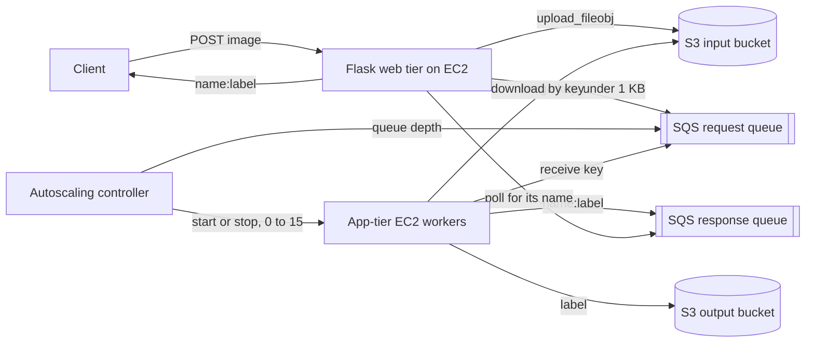
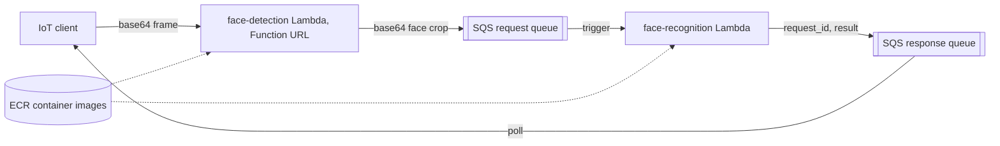
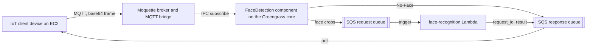

# Elastic Face Recognition

## Card
- One-liner (max 15 words): A face-recognition image pipeline on AWS, built for EC2, Lambda and the edge.
- Role: Solo. Built for ASU's CSE 546 Cloud Computing course in Fall 2025, to the course's specification. The course set the architecture, resource names and limits, and supplied the ML models, the matching routine and starter templates. I wrote the services around them and set up every AWS resource. [course specs: "Every student needs to work independently"]
- Timeline: Fall 2025. Five graded submissions were due Sep 7, Sep 28, Oct 26, Nov 16 and Dec 7, 2025.
- Status: Archived course project. Every AWS resource has been deleted (per Aditya, Nov 2026), so nothing runs and no new screenshots can be taken.
- Links: None, by choice. The course reuses these projects every year and checks submissions for plagiarism, so the code stays private. It lives in four local submission folders, called P1-I, P1-II, P2-I and P2-II below. Project 0 had no code.
- Stack:
  - Compute: Amazon EC2 (a custom AMI with PyTorch, an Elastic IP, tagged worker instances), AWS Lambda (container images, a Function URL, an SQS trigger), and an AWS IoT Greengrass v2 core device running on EC2
  - Storage: Amazon S3 (input and output buckets), Amazon SimpleDB (the lookup table in P1-I)
  - Messaging: Amazon SQS (request and response queues), MQTT through Greengrass (the Moquette broker and the MQTT bridge), AWS IoT Core
  - Registry and access: Amazon ECR, AWS IAM (least-privilege grader users)
  - App: Python, Flask, boto3, requests
  - ML (provided by the course): PyTorch, facenet-pytorch (MTCNN, and InceptionResnetV1 trained on VGGFace2), Pillow, NumPy
  - Infra and CI: none. Resources were set up by hand in the console and the CLI. The submissions contain no infrastructure-as-code and no tests.

## The problem
The course asked for one service, face recognition for photos (Project 1) and for video frames from IoT cameras (Project 2), built three ways: on IaaS, on serverless PaaS, and at the edge. Each version was graded by an autograder that sent 100 requests, checked every answer, and inspected S3, SQS and EC2 while the load ran. The hard parts:
- moving images through queues too small to hold them (the request queue had a 1 KB message limit)
- getting each result back to the right one of 100 concurrent HTTP requests over a shared queue
- scaling from 0 to 15 workers and back without AWS Auto Scaling, which was not allowed
- fitting PyTorch into Lambda

## What I built
- **IAM for grading (Project 0).** A least-privilege `cse546-AutoGrader` IAM user that got only the AWS managed policies the grader needed, widened project by project. [Project 0 spec]
- **The P1-I web tier.** A Flask app on EC2 behind an Elastic IP. It takes a multipart `inputFile` upload, stores the image in the S3 input bucket under its filename, and looks up the label in a SimpleDB domain loaded with 1,000 labels. It returns `<name>:<label>` as plain text. [P1-I web-tier/server.py lines 10–46]
- **The P1-II web tier.** It streams each upload to S3 with `upload_fileobj`, sends only the S3 key to the SQS request queue, and waits up to 120 s on the response queue for its result. Its boto3 clients use adaptive retries, up to 10 attempts. [P1-II web-tier/server.py lines 7–9, 28–57]
- **The autoscaling controller.** A loop runs every 2 s. It reads the request queue's depth, counting waiting and in-flight messages, and starts stopped `app-tier-instance-*` workers up to `min(depth, 15)`. When the queue is empty it stops every running worker. [P1-II web-tier/controller.py lines 9–74]
- **The app-tier worker.** It runs on instances launched from an AMI I built with CPU-only PyTorch and the provided model code. Each worker takes one request, downloads the image from S3 to `/tmp`, runs recognition, and writes the label to the S3 output bucket under the image name. It then posts `<name>:<label>` to the response queue and deletes the request. When the queue is empty, it looks up its own instance ID through IMDSv2 and stops itself. [P1-II app-tier/backend.py lines 38–96]
- **The face-detection Lambda (P2-I).** It sits behind a Function URL. It validates the JSON body (`content`, `request_id`, `filename`), decodes the base64 frame, converts it to RGB and finds faces with MTCNN. It then keeps the box inside the frame, crops the face from the original pixels, re-encodes it as JPEG at quality 95, and queues it as base64 on SQS. [P2-I face-detection/fd_lambda.py lines 23–223]
- **The face-recognition Lambda (P2-I and P2-II).** SQS triggers it. It loads the model once per container and caches the reference faces, averaged into one embedding per person. It resizes each face to 160×160, normalizes it, picks the nearest reference by Euclidean distance, and posts `{request_id, result}` to the response queue. [P2-II face-recognition/fr_lambda.py lines 11–177]
- **The Greengrass face-detection component (P2-II).** It subscribes to `clients/<id>-IoTThing` over Greengrass IPC with QoS 1 and decodes each frame. It detects every face and sends each crop to the SQS request queue. Frames with no faces get a `No-Face` result straight on the response queue (the bonus requirement). [P2-II face-detection/fd_component.py lines 15–96]
- **The edge setup.** A Greengrass core device and an IoT client device, both emulated on EC2. Setting them up meant:
  - the Greengrass nucleus, run as a system service
  - an IoT thing with X.509 certificates and an IoT policy
  - cloud discovery between the client and the core
  - client-device auth
  - the Moquette MQTT broker
  - an MQTT bridge that relays the client topic to IoT Core and to local pub/sub

  [P2-II spec, steps 1–3]

## Architecture
Every version shares one idea: image bytes and queue messages travel separately. In Project 1, images go to S3 and only keys go through SQS. In Project 2, frames come in as base64 over HTTPS or MQTT, and only the cropped faces, which are much smaller, go through SQS.

**Project 1 (IaaS on EC2).** The web tier stores each image in S3 and puts its key on the request queue. The controller watches the queue's depth and starts or stops workers. Each worker pulls a key, fetches the image from S3, runs recognition, writes the label to the output bucket and to the response queue, and the web tier answers the HTTP request.

**Project 2, Part I (serverless).** The client posts a base64 frame to the face-detection function's URL. Detection crops the face and queues it, SQS triggers face recognition, and the client polls the response queue for `{request_id, result}`.

**Project 2, Part II (edge).** Detection moves from Lambda to a Greengrass component on the core device. Frames reach it over MQTT, faces go up to the same recognition Lambda, and frames with no faces are answered on the device.

## AI engineering
This is model serving, not model building. The course supplied:
- MTCNN for face detection
- FaceNet (InceptionResnetV1 trained on VGGFace2) for embeddings
- the reference embeddings
- a nearest-match routine [course `model/face_recognition.py`]

P1-II's `recognize_face` follows that routine almost line for line. My work was running the models under each platform's limits:
- **On EC2,** I baked CPU-only PyTorch and the model code into an AMI, so workers start ready to run inference.
- **On Lambda,** PyTorch is far too large for a zip deployment package, so both functions ran from container images in ECR, following the course's Dockerfile template. The final recognition function builds the model at module scope and caches the reference embeddings in a global. Warm invocations skip both loads, and each SQS batch is handled in one call. [P2-II fr_lambda.py lines 11–13, 16–60, 111–177]
- **Preprocessing.** My detection crops boxes of arbitrary size from the original frame, so recognition resizes every crop to 160×160 and normalizes it as `(x − 127.5) / 128` before taking the embedding. [fr_lambda.py lines 63–84]
- **Matching.** The final version averages the reference embeddings into one per person, then picks the nearest by Euclidean distance. The P2-I folder also holds an earlier version built on the course's TorchScript template, which compares against every reference embedding. [P2-I face-recognition/]
- **A mistake.** The P1-II worker reloads the embeddings file from disk on every request (`torch.load` inside `recognize_face`). It should load once at startup, the way the Lambda version does. [P1-II backend.py line 28]

## Full-stack engineering
Backend and cloud only; there's no UI.

**S3 and image handling.** P1-I writes uploads with `put_object`. P1-II switches to `upload_fileobj`, which streams the upload from Flask's file object into S3 instead of holding the whole image in memory. Each image is stored under its filename. The worker downloads it to `/tmp`, deletes it when done, and writes the label to the output bucket under the image name without the extension. [P1-I server.py line 12; P1-II server.py line 28; backend.py lines 47–54]

**SQS.** The web tier long-polls the response queue with a 1 s wait, up to 10 messages per call and a 2 s visibility timeout. Workers long-poll the request queue with a 5 s wait, and delete a request only after its result is posted, so a worker that dies mid-request leaves the message to be retried. The controller counts `ApproximateNumberOfMessages` plus `ApproximateNumberOfMessagesNotVisible`, so requests in progress still count as demand. [P1-II server.py lines 34–39; backend.py lines 39–53; controller.py lines 47–55]

**EC2.** Workers are pre-created, stopped instances found by a `Name` tag filter, so scaling out means starting an instance, not launching one. The controller caps the pool at 15. Workers stop themselves through IMDSv2: they PUT for a session token, then read their instance ID. [controller.py lines 9–44; backend.py lines 66–85]

**Lambda.** The detection function accepts both a Function URL event (JSON in `body`) and a direct invocation. It returns 400 for a missing field, bad base64 or an unreadable image, and 500 if SQS fails. It reads the queue URL from an environment variable and falls back to finding the queue by name. [fd_lambda.py lines 43–75, 158–191]

**Edge.** The Greengrass component subscribes through the IPC client with `QOS.AT_LEAST_ONCE` and keeps the process alive with a sleep loop. Detection runs with `keep_all=True`, so a frame with several faces sends several crops under one request ID. [fd_component.py lines 19, 30–96]

**IAM.** Each project's grader user got only the managed policies its checks needed. Examples: read-only EC2, S3 and SQS for Project 0; read-only Lambda and full SQS for P2-I; Greengrass read-only and IoT access for P2-II. [course specs]

**Testing.** There are no unit tests. Each version was tested with the course's autograder, which sends a 100-request load and checks results, S3 contents, queue counts and instance counts as the load runs.

## Engineering challenges

### Images that don't fit in the queue
**Problem:** The request queue had a 1 KB maximum message size, set by the spec so images couldn't be sent through it. Face images are many times larger.
**What I did:** I used the claim-check pattern. The web tier streams the image to S3, and the queue message is just the S3 key, the filename. The worker fetches the image by that key, and the result goes to a second bucket and back through the response queue as `<name>:<label>`.
**Result:** Queue messages stay tiny, images live in S3 with their keys, and every result is kept in the output bucket as well as returned to the caller.
**Evidence:** P1-II server.py lines 28–29; backend.py lines 44–52.

### Returning the right result to each of 100 waiting requests
**Problem:** Every HTTP request waits on the same response queue, and SQS can't send a message to a particular reader.
**What I did:** Each request handler polls the queue. It returns the message that matches its own image name. Any other message it deletes and sends back to the queue for the request it belongs to.
**Result:** It works, but each waiting handler keeps receiving and re-sending messages meant for other requests. With 100 requests in flight, that's a lot of extra SQS traffic and added latency. The better design is one background consumer that routes each result to a waiting request by name, using a map of events or futures.
**Evidence:** P1-II server.py lines 31–57.

### Scaling from 0 to 15 and back without AWS Auto Scaling
**Problem:** The spec banned AWS Auto Scaling. It required 0 instances when idle, at most 15, one request per instance at a time, and a worker stopping as soon as no work is left.
**What I did:** I wrote a 2-second control loop that matches running workers to queue depth, capped at 15, and starts pre-stopped instances. Scale-in happens two ways: each worker stops itself when it finds the queue empty, and the controller stops any that are still running.
**Result:** The pool tracks the queue and drops to zero right after the last request. Two things I'd change: the loop's bare `except:` hides AWS errors, and instances are started one API call at a time when `start_instances` accepts a list.
**Evidence:** P1-II controller.py lines 9–16, 63–74; backend.py lines 87–96.

### Answering empty frames at the edge
**Problem:** In the edge version, frames with no faces still cost a round trip to the cloud for nothing. The bonus requirement asked for them to be answered on the device.
**What I did:** When MTCNN finds no boxes, the Greengrass component posts `{"request_id": …, "result": "No-Face"}` straight to the response queue and skips the request queue and the recognition Lambda.
**Result:** Frames with no faces never reach the cloud's compute; only a small result message leaves the device.
**Evidence:** P2-II fd_component.py lines 50–57.

## By the numbers
| Number | What it counts | How I verified it |
|---|---|---|
| 3 | Ways the service was built (EC2, Lambda, Greengrass edge) | The four submission folders |
| 5 | Graded submissions, Project 0 to Project 2 Part II | Course specs and the submission folders |
| 9 | AWS services used | EC2, S3, SQS, SimpleDB, Lambda, ECR, IAM, IoT Core, IoT Greengrass |
| 0–15 | Size of the EC2 worker pool | `min(..., 15)` in controller.py |
| 2 s | Autoscaler control loop interval | `time.sleep(2)` in controller.py |
| 1 KB | Largest request message; only S3 keys fit | Spec; server.py sends `file_name` only |
| 2 | S3 buckets (input images, output labels) | server.py, backend.py |
| 2 | Lambda functions (detection, recognition) | fd_lambda.py, fr_lambda.py |
| 120 s | How long the web tier waits for a result before returning 504 | server.py line 31 |

## Media
No screenshots exist, and none can be taken now that the AWS resources are deleted. Use the three architecture diagrams above. On the portfolio, the project uses a line drawing: an image goes into an S3 bucket, its name goes through a queue, and workers fetch the image by key.

## Résumé check
- The project isn't on the PDF résumé. ASU coursework lists "Cloud Computing", and the skills list "AWS".
- "AWS" in skills: **Confirmed and now specific.** This project covers EC2, S3, SQS, Lambda, ECR, IAM and IoT Greengrass.
- Suggested bullet: "Built an elastic face-recognition pipeline on AWS three ways (EC2, Lambda, IoT Greengrass): a Flask web tier streaming images to S3 with key-only SQS messages, a custom autoscaler for 0–15 EC2 workers, and PyTorch inference in Lambda container images on ECR."

## Open questions for Aditya
1. Do you want the suggested bullet on the PDF résumé? `data/resume.ts` now lists the project, but the PDF doesn't.
