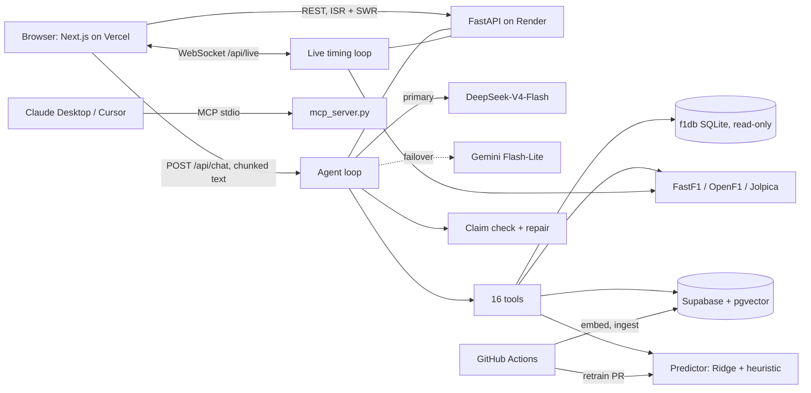

# F1 AI

## Card
- One-liner (max 15 words): An agentic AI race engineer that answers Formula 1 questions from real data.
- Role: Solo project. I designed the product, architecture, data pipeline and ML approach, and I wrote the code with AI coding agents (Claude Code), with every change gated by tests and CI. [.planning/PROJECT.md; commit trailers]
- Timeline: Jan 2026 – present. The first commit is dated Jan 3, 2026. The agent, retrieval and retraining work landed in July 2026, and the latest release merged on Nov 4, 2026.
- Status: Live; UI redesign in progress.
- Links: https://f1-ai-delta.vercel.app · https://github.com/amurark3/F1-AI
- Stack:
  - Frontend: Next.js 16, React 19, TypeScript, Tailwind CSS 4, SWR, Recharts
  - Backend: Python 3.13, FastAPI, Pydantic, structlog
  - Data: f1db SQLite (1950 to present), FastF1, OpenF1, Jolpica, FIA documents, Supabase Postgres + pgvector
  - AI: LangChain; DeepSeek-V4-Flash (AMD Token Lab) with Gemini failover; MiniLM embeddings; cross-encoder reranker; scikit-learn Ridge; FastMCP
  - Infra & CI: Render, Vercel, Supabase; 7 GitHub Actions workflows; Sentry

## The problem
F1 fans ask questions that cross many sources at once: last Sunday's result, a 1960s record, a tyre strategy, a regulation. General chatbots answer from stale training data and invent drivers, teams and numbers. The data is spread across f1db, FastF1, OpenF1 and FIA PDFs, and for hours after a race those sources disagree [docs/DATA_SOURCES.md]. The hard part was getting an LLM to state only facts it had actually fetched, on a 512 MB free-tier server with rate-limited model APIs.

## What I built
- A hand-written agent loop on LangChain tool calling. It allows up to 3 tool turns over 16 tools and ends with a forced turn with no tools bound. Tool timeouts and errors come back to the model as text. [backend/app/api/routers/chat.py]
- Engine failover. A question that hits an HTTP or network error on DeepSeek-V4-Flash restarts on Gemini, and the failed engine rests for 60 s or 10 min, depending on the status code. [backend/app/api/llm.py]
- Guarded text-to-SQL over 1950–2026. The connection is read-only and accepts one SELECT/WITH statement. A keyword denylist, a 50-row cap and a 5-second budget back that up, and tallies counted in code ride along with every result. [backend/app/data/f1db_query.py, backend/app/api/tools/tallies.py]
- A claim checker that compares each driver↔team statement in an answer with the tool tables, then requests one repair or appends a "Data check" line. [backend/app/api/claim_check.py, answer_repair.py]
- FIA regulation retrieval over 12 PDFs, using pgvector HNSW search and cross-encoder reranking (24 → 6), with page citations. [backend/app/rag/, backend/app/api/tools/reference.py]
- A race-finish predictor: Ridge over 9 shared features, blended 65/35 with a heuristic, plus per-driver corrections learned from past misses. Its attributions are exact. [backend/app/ml/, backend/app/data/predictions/]
- A weekly retraining Action that promotes a model only if it matches or beats the grid-order baseline. Thirteen retrains have shipped through auto-merged PRs. [.github/workflows/retrain.yml, backend/app/ml/promote.py]
- A Next.js "Race Control" workspace: Command Center, AI Engineer chat with live tool status, Grand Prix Hub, Telemetry Lab, and a power-unit tracker parsed from FIA documents. [frontend/app/race-control/]
- A live-timing WebSocket that follows a race weekend session by session. [backend/app/api/live/websocket.py]
- An MCP server with 10 F1 tools and a health check for Claude Desktop or Cursor. [backend/mcp_server.py]

## Architecture
The browser talks to one FastAPI service. Pages read REST endpoints through ISR-cached server fetches and SWR. Chat is a `POST /api/chat` that returns a chunked text stream, and live timing uses a WebSocket. Agent tools read a read-only local copy of f1db (kept on the newest release), FastF1 and OpenF1, and Supabase. Heavy jobs run in GitHub Actions instead of on the 512 MB web instance: embedding, FIA document ingest and retraining.

## AI engineering
**Models.** The engine list lives in code, so a model change goes through review [backend/app/config.py]. I moved from Gemini to Groq in July 2026, then to Token Lab with Gemini failover on Nov 1, because Groq's 8K tokens-per-minute tier couldn't carry one question and its model malformed tool calls [commit beb77b7].

**Prompt.** The system prompt combines the persona (with refusal rules for role changes and off-topic requests), the date, optional user memory, tool-routing rules, and a grounding contract. Under that contract the model states a fact only if a tool returned it, makes at most three observations, each tied to a row, and never says "only" or "first" unless a tool did [chat.py `build_system_prompt`].

**Loop.** I wrote the loop myself so I control the turn budget, the progress markers and failover. Every turn re-sends the tool schemas, so turns are capped at 3 to protect quota [config.py `MAX_AGENT_TURNS`]. If the model still asks for a tool on the last turn, the history is folded into plain text and the model is asked again [chat.py].

**Retrieval.** PDFs are split into 1,000-character chunks with 200 characters of overlap, embedded at 384 dimensions, filtered by season, and reranked [backend/app/rag/]. In production the torch models are switched off (`ENABLE_LOCAL_MODELS=false`), because one rulebook query OOM-killed the server [DEPLOYMENT.md §2]. Rulebook search runs locally and in the ingest job.

**Text-to-SQL.** The model sees a curated schema of 8 tables with a worked example. Rejected queries come back as text it can fix [f1db_query.py].

**Evals.** `scripts/eval_answers.py` runs real questions through the shipped agent and scores the answers against f1db. A golden set of 5 questions with an LLM judge gates at 0.7 [backend/app/evals/]. On Nov 1, DeepSeek-V4-Flash answered 12 of 12 samples, 11 cleanly [commit beb77b7].

**Cost.** Free tiers drove most of these choices: lazy imports, a final turn with no tools bound, one retry before failover, and Gemini's thinking level set to low [config.py].

**ML.** Training and serving share one feature builder [backend/app/ml/features.py]. I picked Ridge because gradient-boosted trees overfit and lost to a "predict the grid order" baseline in backtests [train.py]. The promotion gate backtests the four most recent seasons season by season [promote.py].

## Full-stack engineering
**Frontend:** 23 App Router pages. ISR windows are grouped by how fast each kind of data changes, and a warm-up gate holds the app while Render cold-starts [frontend/app/lib/server/revalidate.ts, components/ServerWarmingGate.tsx].
**API:** 49 handlers covering chat, standings, race detail, predictions, Race Control, Telemetry Lab, profiles, power units, memory and health. Clients get a generic error message with a correlation ID [backend/app/api/].
**Data model:** Supabase holds `app_documents` (JSONB), `analysis_cache`, `user_profile`, `chat_message` and `rulebook_chunk`, with row-level security and no policies [backend/app/data/rls.sql].
**Real-time:** Agent progress travels as `[TOOL_START]`/`[TOOL_END]` markers in a chunked HTTP response [frontend/app/hooks/useChat.ts]. Live timing is a WebSocket with heartbeats [backend/app/api/live/].
**Auth:** There are no accounts. A random localStorage ID keys memory.
**CI/CD:** Render auto-deploys `main`. PRs run ESLint, the build, Vitest, Playwright, Ruff and pytest with a 100% coverage gate [.github/workflows/pr-auto-review.yml].

## Engineering challenges

### Two torch models on a 512 MB server
**Problem:** One rulebook query loaded the embedder and the reranker and OOM-killed the container, taking down every endpoint.
**What I did:** I put every torch import behind `ENABLE_LOCAL_MODELS`, dropped torch from the runtime requirements, and made rules search report that it is disabled.
**Result:** Boot takes about 0.8 s, and the build skips about 2 GB of torch. The trade-off is that rules search is off in production.
**Evidence:** DEPLOYMENT.md §2–3, §11; backend/app/utils/embeddings.py.

### Answers that contradicted their own data
**Problem:** With the right rows in front of it, the model still paired drivers with the wrong teams and merged two weekends into one "double."
**What I did:** I added tallies counted in code, a grounding contract and a claim checker with one repair pass.
**Result:** 12 of 12 samples answered on Nov 1, 2026, 11 of them cleanly.
**Evidence:** backend/app/api/tools/tallies.py, claim_check.py, scripts/eval_answers.py, commit beb77b7.

### Retries that multiplied work until the server died
**Problem:** `wait_for(to_thread(...))` stops waiting but doesn't stop the thread, so each "Try again" started another prediction run until memory ran out.
**What I did:** I added a single-flight registry keyed by race and phase. Requests join the running task through `shield`, and the UI polls for the snapshot.
**Result:** One compute per race, however many clicks.
**Evidence:** commit e21a37c; backend/app/api/single_flight.py.

### Free-tier LLM quotas
**Problem:** Binding every tool cost about 2,100 prompt tokens per turn against an 8K-per-minute limit.
**What I did:** First I added a keyword tool router and a parser for malformed inline tool calls. Then I switched engines and added failover.
**Result:** Every tool is bound again, and an exhausted engine hands off without a user-visible error.
**Evidence:** commits 7d0eb45, beb77b7; backend/app/api/llm.py.

## By the numbers
| Number | What it counts | How I verified it |
|---|---|---|
| 16 | Chat agent tools | `TOOL_LIST` in tools/__init__.py |
| 11 | MCP tools (10 F1 + health check) | `@mcp.tool` count |
| 3 | Max agent tool turns | `MAX_AGENT_TURNS` |
| 77 | Seasons queryable (1950–2026) | f1db schema doc |
| 12 | FIA regulation PDFs, 2024–2026 | `backend/data/raw/` |
| 9 | Model features | `FEATURES` in features.py |
| 13 | Auto-retrained models merged | `git log origin/main`, Jul 21 – Nov 3, 2026 |
| 49 | API route handlers | grep of route decorators |
| 23 | Next.js page routes | `find … page.tsx` |
| ~3,270 | Backend test functions, 177 files | grep of `def test_` |
| 100% | Backend coverage gate | `.coveragerc` `fail_under` |

## Media
In the repo: `frontend/app/opengraph-image.png` (1200×630 brand card), `frontend/app/icon.svg` (logo) and `frontend/public/hero-car.jpg` (check its license).

Screenshots to capture:
1. The AI Engineer mid-answer, showing "Running Query F1 Database", then the finished table.
2. The Grand Prix Hub Predictions tab with per-feature model factors.
3. The Telemetry Lab speed map and head-to-head traces.

## Résumé check
- "LangChain and Groq": **Needs correction.** Groq ran the agent from Jul 20 to Nov 1, 2026; the system now uses DeepSeek-V4-Flash with Gemini failover.
- "15 specialized tools": **Needs correction.** It's 16 since Oct 24, 2026.
- "live telemetry": **Needs correction.** The agent compares past lap telemetry; live timing is a separate feature.
- "dynamic tool selection and error recovery": **Needs correction.** Both were removed on Nov 1. Use "engine failover and claim checking."
- "pgvector… cross-encoder reranking": **Confirmed** in code, but switched off in production.
- "constrained text-to-SQL… 75+ years": **Confirmed.**
- "Next.js, FastAPI, and WebSockets": **Confirmed.**
- "streams agent execution progress": **Needs correction.** It streams over chunked HTTP, not WebSockets. Fix `portfolio-site/index.html` too.
- "11 analysis tools… MCP": **Needs correction.** It's 10 tools plus a health check.
- "May–Jul 2025": **Can't verify.** Git starts in Jan 2026.

## Open questions for Aditya
1. Did any work happen before the Jan 2026 first commit?
2. Is `ENABLE_LOCAL_MODELS` still `false` on Render?
3. Is the Role line's mention of AI coding agents OK with you?
4. Can you share `python -m app.ml.evaluate` output so I can add the model metrics?
5. Should the MCP rulebook tool (which still uses ChromaDB) be fixed first?
6. Where is `hero-car.jpg` from?
