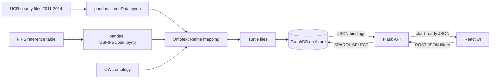

# Gotham Watch

## Card
- One-liner (max 15 words): A US county crime dashboard backed by an RDF knowledge graph and SPARQL.
- Role: Solo. I built it end to end for an ASU graduate course: data extraction and cleaning, the ontology and RDF mapping, the GraphDB load on Azure, the Flask API, and the React UI. [per Aditya; both repos are under my account, and every commit is mine]
- Timeline: Oct–Dec 2024. Code commits run from Nov 17 to Dec 6, 2024, and I did a documentation pass in Feb 2026.
- Status: Archived course project. The Azure-hosted GraphDB server no longer responds (checked Nov 2026), so the app can't run end to end until the RDF files are loaded into a new GraphDB instance.
- Links: https://github.com/amurark3/gotham-watch (frontend) · https://github.com/amurark3/backend (backend) · No live demo. The GitHub Pages URL returns HTTP 200 but renders a blank page.
- Stack:
  - Frontend: React 18, Vite, React Router, Ant Design, react-simple-maps with d3-scale, react-google-charts
  - Backend: Python, Flask (4 blueprints), Flask-CORS, requests
  - Data: Ontotext GraphDB, SPARQL 1.1, OWL ontology (Protégé), Ontotext Refine, pandas, US county TopoJSON
  - AI: None
  - Infra & CI: GraphDB on Microsoft Azure; API and UI ran locally for the demo; a GitHub Pages workflow (Jekyll template), no automated tests

## The problem
US crime statistics come as large flat files keyed by numeric state and county codes. That makes it hard for a resident or a public-safety analyst to answer questions like "what kinds of crime show up in my county?" or "where are the hot spots?" I used the FBI Uniform Crime Reporting (UCR) county-level files for 2011–2014 from ICPSR at the University of Michigan, plus a separate state and county FIPS reference table [Report §V, refs 12–16]. The hard part was merging two sources that formatted their codes differently into one model you can query, then turning about 400K triples into a map and a chart that respond to filters.

## What I built
- A pandas cleaning step that turns raw UCR rows into hierarchical IDs (`ST_4` → `ST_4_CT_13` → `ST_4_CT_13_2013`), so each state, county, and county-year gets its own IRI. [gotham-watch/src/scripts/crimeData.ipynb]
- A matching cleanup of the FIPS reference table that produces the same county IDs, so the two datasets join on shared IRIs inside the graph with no join table. [gotham-watch/src/scripts/USFIPSCode.ipynb]
- An OWL ontology in Protégé, and the RDF data mapped onto it in Ontotext Refine: 12,710 county-year records for 3,178 counties in 51 jurisdictions, 88,970 crime-category nodes, and 397,441 distinct triples. [Report §VI, §VII.4; gotham-watch/src/TTL/]
- A Flask API with four POST endpoints. Each one builds a SPARQL query, sends it to GraphDB, and reshapes the results into chart-ready JSON. [backend/app.py, backend/routes/]
- A small SPARQL client that posts form-encoded queries to GraphDB and asks for JSON results. The endpoint comes from an environment variable. [backend/utils/sparql_helper.py, backend/config.py]
- A US county choropleth that shades 3,221 county shapes by total crime count for any combination of years. [gotham-watch/src/screens/HeatMap.jsx, backend/routes/use_case_4.py]
- A cascading Year → State → County filter that draws a donut chart of seven crime categories. [gotham-watch/src/screens/CrimeVisualization.jsx, backend/routes/use_case_1.py to use_case_3.py]
- A four-page React app (Home, Heat Map, Crime Visualization, Resources) with Ant Design navigation that stays in sync with the URL. [gotham-watch/src/App.jsx, gotham-watch/src/screens/Header.jsx]

## Architecture
The system works in two phases. Offline, pandas notebooks clean the UCR county files and the FIPS table into CSVs with consistent IDs. Ontotext Refine maps those CSVs onto my OWL ontology to produce RDF, which the repo keeps as two Turtle files, and I loaded it into a GraphDB repository hosted on Azure [Report §VII.4–5]. Online, React sends JSON POST requests to Flask. Flask turns the filter values into a SPARQL SELECT query, posts it to GraphDB over HTTP, and reshapes the results into dropdown options, a Google Charts table, or `{id: FIPS, value: total}` pairs for the map. React renders those as-is, with no aggregation in the browser.

## AI engineering
Not applicable. Gotham Watch has no ML, NLP, or LLM code. The report mentions machine learning only as future scope [Report §XI].

## Full-stack engineering
**React app and visualizations.** The app is React 18 on Vite, with four React Router routes and Ant Design `Layout`, `Menu`, `Select`, and `Card` [gotham-watch/src/App.jsx]. The heat map uses `react-simple-maps` with an Albers USA projection over a county TopoJSON, colored by a five-shade `d3-scale` `scaleQuantize` [screens/HeatMap.jsx]. The crime breakdown is a `react-google-charts` PieChart with `pieHole: 0.4`, which renders as a donut [screens/CrimeVisualization.jsx].

**Flask API.** Four blueprints under `/api`, all POST with JSON bodies [backend/routes/]. `use-case-1` returns states. `use-case-2` returns a state's counties. `use-case-3` returns a Google Charts table of seven categories for one state, county, and year. `use-case-4` takes a list of years and returns `[{id, value}]` for the map. Empty results return a 404 with a readable message.

**Ontology and data model.** The ontology has four classes (State, County, CrimeYear, CrimeCategory), three object properties (`hasCounty`, `hasCrimeYear`, `hasCrimeCategory`), and four data properties (`hasStateName`, `hasCountyName`, `hasFIPSCode`, `hasFrequency`) [Report §VI; these match the predicates in the TTL files]. Each county-year is its own node with seven crime-category children.

**SPARQL query layer.** Four SELECT queries. They use `BIND(STRAFTER(STR(?state), "#"))` to turn IRIs into dropdown codes, `FILTER` on state, county, and year, and `GROUP BY` with `GROUP_CONCAT` for map totals [backend/routes/; Report Figs. 8–11].

**ETL.** The notebooks build prefixed IDs, fill missing counts with 0, and remove duplicate counties. Ontotext Refine produced the Turtle [scripts/*.ipynb; Report §VII.4].

**Deployment.** GraphDB ran on Azure, and Flask reads its address from `SPARQL_ENDPOINT` [backend/config.py; Report §VII.5]. The UI and API ran locally for the demo, and the report's screenshots show `localhost:5173` [Report Figs. 4–5].

**Testing.** Neither repo has automated tests. I checked the data against the source files and ran the queries against expected results by hand [Report §XII].

## Engineering challenges

### Joining two datasets that formatted their codes differently
**Problem:** The crime files identify counties by separate numeric codes. The map uses 5-character FIPS strings such as `04013`, and 310 FIPS codes in the reference table had lost their leading zero.
**What I did:** I gave both notebooks the same ID scheme (`ST_{state}_CT_{county}`), so crime nodes and FIPS nodes resolve to the same IRI, and I zero-padded 4-digit FIPS codes in the API.
**Result:** 3,131 of 3,178 crime counties link to a map shape. 47 don't, so they're missing from the map and the dropdown.
**Evidence:** gotham-watch/src/scripts/*.ipynb; backend/routes/use_case_4.py lines 71–73; join of both CSVs.

### Crime counts stored inside strings
**Problem:** The mapping stored each count inside a string, such as `"ST_1_CT_1_2014_DUI_84"^^xsd:String`, so SPARQL couldn't `SUM` it.
**What I did:** For the map, I `GROUP_CONCAT` each county's count strings in SPARQL, then split and sum them in Python. For the chart, I parse the number after the last underscore.
**Result:** Both views show correct totals, but aggregation is split between the database and the API. Typed integers would let a single `SUM` query do it.
**Evidence:** gotham-watch/src/TTL/crimeData.ttl; backend/routes/use_case_3.py line 78; use_case_4.py lines 35–85.

### A heat map that saturates and hides missing data
**Problem:** The color scale has a fixed domain of 0–100, but the median county's 4-year total is 523. Missing counts were filled with 0, so all 68 Florida counties and 95 of 102 Illinois counties show as lowest-crime.
**What I did:** I shipped with the placeholder domain, which I now count as a mistake. For this write-up I recomputed the API's totals from the cleaned CSV to measure the problem.
**Result:** 84.7% of mapped counties land in the darkest shade, which matches the mostly dark-red map in Report Fig. 14. The fix is a quantile or log scale, per-capita rates, and a separate "no data" color.
**Evidence:** screens/HeatMap.jsx lines 13–15; crimeData.ipynb `fillna(0)`; Report Fig. 14, p. 7.

### Deploying a Vite single-page app to GitHub Pages
**Problem:** A project-site path (`/gotham-watch/`) needs a matching Vite `base` and router `basename`, and the UI called the API at `localhost:5000`.
**What I did:** I added both settings and a `gh-pages` script on Dec 5, 2024, then reverted the path changes on Dec 6 and demoed locally.
**Result:** Pages still serves an unbuilt `index.html` that renders blank. It should be fixed or turned off.
**Evidence:** commits 92abe93, 46c4725, acacb86; `curl` checks, Nov 2026.

## By the numbers
| Number | What it counts | How I verified it |
|---|---|---|
| 4 | Flask endpoints | Blueprint registrations in `app.py` |
| 4 | SPARQL SELECT queries | grep of `routes/*.py`; Report Figs. 8–11 |
| 2 | Chart types (choropleth, donut) | `HeatMap.jsx`, `CrimeVisualization.jsx` |
| 7 | Crime categories | `use_case_3.py` mapping |
| 12,710 | County-year records, 2011–2014 | Row count of `transformed_crime_data.csv` |
| 3,178 | Counties with crime data | Distinct county IDs in that CSV |
| 397,441 | Distinct triples in the two TTL files | My own tokenizer script, not checked in GraphDB |
| 3,131 | Counties linked to a FIPS code | Join of both CSVs on county ID |
| 84.7% | Mapped counties in the darkest shade | Recomputed the use-case-4 totals from the CSV |

## Media
Already available: `Report/1739999875566.jpeg` (landing page), `Report/1739999902800.jpeg` (heat map, 2011 and 2014), `Report/1740000021305.jpeg` (donut chart, Hudson County NJ, 2011), `Report/1739999842193.jpeg` (resources page). The report PDF also has Protégé ontology views (Figs. 1–3, p. 4) and the SPARQL queries (Figs. 8–11, pp. 5–6).

Screenshots to capture (load the TTL files into a local GraphDB first):
1. GraphDB's visual graph of one county, showing county → county-year → seven crime-category nodes.
2. The Crime Visualization page with all three filters set and the donut chart drawn.
3. A SPARQL query in GraphDB's editor next to the JSON the Flask endpoint returns.

## Résumé check
- "Built an interactive crime analysis platform": **Confirmed: solo build, per Aditya.**
- "React and dynamic data visualizations": **Confirmed.** A filter-driven county choropleth and a donut chart.
- "Python and Flask APIs": **Confirmed.** Four Flask blueprints.
- "SPARQL queries over a GraphDB knowledge graph": **Confirmed** in the code and the report. The live graph can't be checked because the server is down.
- "deployed on Microsoft Azure": **Needs correction.** Only GraphDB was on Azure [Report §VII.5, §XIV]. The app ran locally, and neither repo has Azure deployment config. Fix: "…over a GraphDB knowledge graph hosted on Microsoft Azure." Update `data/resume.ts` and `portfolio-site/index.html` to match.

## Open questions for Aditya
1. Which Azure service ran GraphDB, and did Flask ever run on Azure? Your local backend README has an uncommitted "App Service" section with no config behind it.
2. Where were the four yearly ICPSR files merged into `combined_crime_data.csv`? That step isn't in either repo.
3. Did the source files count arrests or reported offenses? Fraud, weapons, and DUI suggest the arrest tables.
4. The report mentions DBpedia links, hate-crime data, and 2012–2016 coverage, none of which are in the code. Were they ever built?
5. Do you still have the Protégé OWL file?
