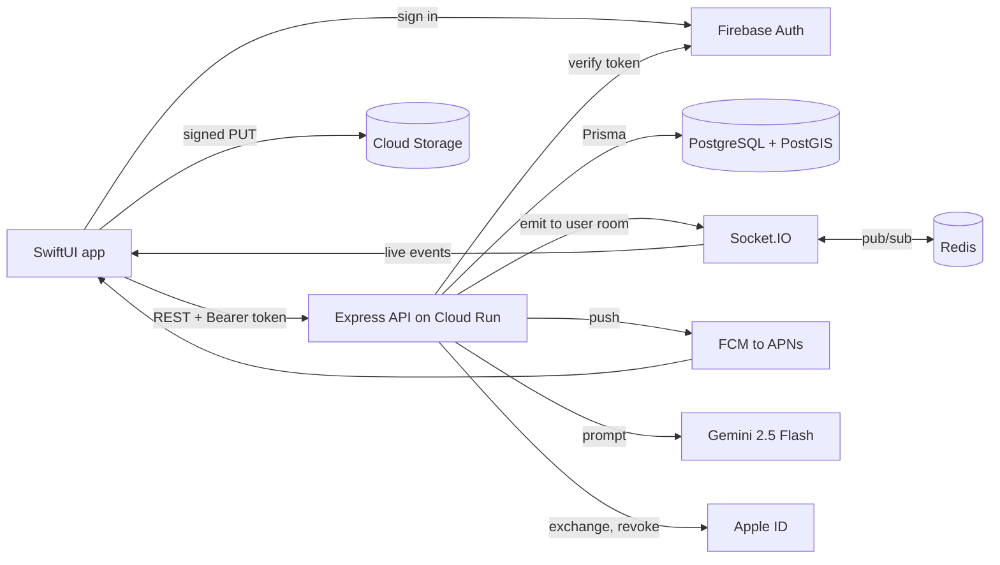

# WeVibe

## Card
- One-liner (max 15 words): An iOS dating app built around timed speed-dating chats, real-time messaging, and AI-written bios.
- Role: Team of 6 (Arizona State University course project). I built most of the SwiftUI iOS client and added backend pieces for photos, location sync, push notifications, Apple Sign-In, and bio rate limits. Teammates owned the matchmaking engine, the chat and Socket.IO server, most REST endpoints, and deployment.
- Timeline: Jan–May 2026. My commits run from Feb 17 to Apr 23, 2026.
- Status: Finished course project. The team's Cloud Run backend still returned HTTP 200 from `/health` on Nov 8, 2026. A TestFlight lane exists, but the repo doesn't show whether a build reached testers.
- Links: Private. The team's GitHub repo returns 404 to the public. No public demo.
- Stack:
  - Frontend: Swift, SwiftUI (iOS 17, `@Observable`), Firebase iOS SDK (Auth, Messaging, Crashlytics), Google and Apple sign-in, socket.io-client-swift, CoreLocation
  - Backend: Node.js 20, TypeScript, Express 4, Socket.IO 4 with the Redis adapter, firebase-admin
  - Data: PostgreSQL 15 + PostGIS through Prisma 6, Cloud Storage signed URLs, Upstash Redis
  - AI: Google Gemini 2.5 Flash
  - Infra & CI: Docker and Cloud Run (a teammate's setup), XcodeGen, fastlane match and TestFlight; Jest tests run by hand; no CI pipeline

## The problem
WeVibe pairs two nearby, compatible people from a live queue into a speed-dating chat. The chat lasts 24 hours with 20 messages each, and it becomes a permanent match only if both say yes [backend/src/services/matchmaking-service.ts, speed-dating-service.ts]. That makes it a real-time, two-party system: both phones have to agree on the session, the messages, and the decision, even while one phone is offline. My job was to make that work on iOS and fill the backend gaps the client needed.

## What I built
- The app shell: one `AppState` enum swaps the whole view tree, and `@Observable` stores are injected through the environment. [App/RootView.swift, PR #25]
- Firebase sign-in on iOS (email, Google, Apple), plus backend register, login, and profile creation that are safe to retry after a lost response. [Services/AuthManager.swift, auth-service.ts, commit 436976ea]
- Apple Sign-In revocation: the server signs an ES256 client secret, exchanges Apple's one-time code for a refresh token, and revokes that token when the account is deleted. [apple-auth-service.ts, user-service.ts, PR #112]
- Profiles and photos: 11 edit sheets, cropping, a drag-to-reorder grid, and signed-URL uploads with retries, an idempotent finalize step, and an hourly orphan cleanup job. [Views/ProfileEditSheets.swift, jobs/photo-cleanup.job.ts, PR #64]
- Location sync: the phone reports after 500 m of movement and syncs after 1 km or a ZIP change. `PATCH /users/profile/location` updates both the lat/lng columns and the PostGIS point, with 13 tests. [Services/LocationManager.swift, tests/profile-location.test.ts, PRs #107, #108]
- `ChatStore`, one store for the chat list: live previews, unread badges, typing indicators, read receipts, and a re-sync when the app returns to the foreground. [Services/ChatStore.swift, App/WeVibeApp.swift, PR #128]
- The iOS Socket.IO client and queue flow, including ending a session early and blocking users with no photo from the queue. [Services/SocketService.swift, MatchmakingService.swift, PRs #81, #101]
- FCM push end to end: token sync, stale-token cleanup, one notification thread per match, no banner when you're already in that chat, and tap-to-open. [App/AppDelegate.swift, notification-service.ts, PRs #113, #128]
- Rate limits for the bio generator (5 per day, 60-second cooldown) and the "Generate Bio with AI" button. [bio-generator-service.ts, PR #128]
- Build tooling: XcodeGen, fastlane signing and TestFlight lanes, git hooks, Crashlytics logging, and a privacy manifest. [frontend/iOS/project.yml, fastlane/Fastfile, PR #87]

## Architecture
The app signs in with Firebase and sends the ID token as a Bearer token on every request. Express verifies the token with the Firebase Admin SDK and reads and writes PostgreSQL through Prisma. Matchmaking runs in a transaction with Postgres advisory locks and PostGIS distance checks. After a write such as a new message, the API emits an event to the recipient's Socket.IO room, which the Redis adapter delivers across instances, and also sends an FCM push for when the app is closed. Photos go straight to Cloud Storage. Gemini runs on the server, so the API key never ships in the app.

## AI engineering
A teammate built the Gemini integration and the prompt (PRs #104, #129). I added the limits, the error handling, and the iOS feature (commits f4e1fa88, c16cf938), and I merged the two versions (9351b719).

- **Prompt:** seven profile fields go into the prompt as JSON in a `<user_profile>` tag. The rules cap the bio at 400 characters, ban filler words, and pick one of three "vibes." An optional style hint is cut to 150 characters and wrapped in `<user_preferences>` with anti-override instructions. Safety filters block medium-and-above harmful content. In my merge I set `thinkingBudget: 0` because the model's reasoning was leaking into the output.
- **Limits:** three new `profiles` columns track the last generation time and a daily count tied to a UTC date. The server returns 429 `BIO_LIMIT_EXCEEDED` after 5 a day and 429 `BIO_COOLDOWN` with the seconds to wait, and every success returns `remainingToday`. I also moved the route from `/users/:id/generate-bio` to `/users/profile/generate-bio`, so the user comes from the token, not the URL.
- **Failures:** output is trimmed, an empty reply throws, and long output is cut to 500 characters. Counters update only after a success, so a failed call doesn't use up a try. iOS shows 429 messages as-is.

No evaluation set, retries, or streaming.

## Full-stack engineering
**iOS:** `@Observable @MainActor` stores (auth, profile, chat, socket, matchmaking) are injected at the root, and each flow has its own `NavigationPath` router. A `ViewState<T>` enum models loading and failure states.

**API:** 43 REST routes under `/api/v1`, all with a `{ success, data | error }` envelope. I added `PATCH /users/profile/location` and `PATCH /users/fcm-token`, re-pathed bio generation, and added cursor pagination (`before`, `limit`, `hasMore`) to match messages.

**Data:** 10 Prisma models, 12 enums, and a PostGIS `geography` point with a GiST index. I added `photo_upload_pending`, the push and Apple token columns, and the bio limit columns.

**Real-time:** the server emits to per-user rooms. `SocketService` exposes the latest event of each type, and the app root applies events to `ChatStore`. Returning to the foreground re-fetches both lists. My queue recovery code polls queue status after the socket reconnects, but it expects `{ state, sessionId }` while the backend returns `{ inQueue }`, so it never fires.

**Push and auth:** each message sends a socket event and an FCM push, and iOS hides the banner if you're already in that chat. Identity lives in Firebase, and app data lives in Postgres.

**Deploy and tests:** a teammate deployed to Cloud Run. I set up iOS signing and TestFlight. The backend has 140 Jest cases against a real Postgres with mock auth, and I wrote 29 of them. There are no iOS tests and no CI.

## Engineering challenges
### Photo uploads that don't leak files
- Problem: a failed finalize left orphaned files in storage, and a retry could save the same photo twice.
- What I did: the client retries finalize three times with backoff. The server tracks pending uploads, finalize is idempotent and transactional, and an hourly job deletes uploads that never finalized. Deletes now update the database first.
- Result: retries don't create duplicates, and abandoned files get cleaned up.
- Evidence: commit 436976ea; photo-controller.ts, photo-cleanup.job.ts

### Sign-up that survives lost responses
- Problem: if the 201 response was lost, the retry returned 409. A rolled-back Firebase account also left a stale UID in the database.
- What I did: register and profile creation return the existing record, and login re-links a stale UID by email.
- Result: users don't get stuck halfway through sign-up.
- Evidence: commit 436976ea; auth-service.ts, profile-service.ts

### A chat list that stays current
- Problem: the list re-fetched on every visit and ignored socket events, so badges went stale.
- What I did: I built `ChatStore`, connected the socket events to it, and added mark-as-read calls. When a push opens the app before the matches have loaded, the app waits for them and then opens the chat.
- Result: live previews and badges, and taps open the right chat.
- Evidence: commits 8999da3b, 040a197a, a52880e3

### Apple accounts that can be revoked
- Problem: App Store guideline 5.1.1 requires revoking the Apple token on account deletion, and Firebase alone doesn't give the backend that token.
- What I did: the app captures the one-time code before the Firebase sign-in. The server signs an ES256 JWT (P1363 encoding, not Node's default DER), exchanges the code without blocking login, and revokes the token on deletion.
- Result: full revocation on delete, covered by 7 tests.
- Evidence: PRs #112, #113; apple-auth-service.ts

## By the numbers
| Number | What it counts | How I verified it |
|---|---|---|
| 6 | Contributors | `git shortlog -sne` (duplicate emails merged), PR authors |
| 40 of 131 | PRs I opened, all merged (25 feature) | GitHub GraphQL API |
| 21 | Teammate PRs I reviewed | GitHub GraphQL API |
| 82 of 257 | My non-merge commits on `develop` | `git log --no-merges` |
| ~69% | Current iOS Swift lines attributed to me | `git blame` (approximate) |
| 43 | REST routes | grep of `backend/src/routes` |
| 140 / 29 | Backend test cases, total / mine | grep of `it(`/`test(` |
| 5/day, 60 s | Bio limits | constants in code |

## Media
In the repo: `frontend/iOS/WeVibe/Assets.xcassets/AppIcon.appiconset/WeVibe Background App Logo.png` (app icon) and the logo image sets. There are no screenshots.

Capture:
1. The chat list with an unread badge and a typing indicator.
2. The About Me sheet showing "Generate Bio with AI" and "N generations left today."
3. A grouped push notification and the chat it opens.

## Résumé check
- End-to-end flows (auth, onboarding, profiles, photos, location, matchmaking, chat): **Needs correction.** Photos and location sync are end to end. For auth, onboarding, and profiles, my work is mostly iOS. The matchmaking engine and the chat backend are **teammates' work**. Fix: "Built SwiftUI flows for sign-in, onboarding, profiles, photos, location, matchmaking, and chat, and extended the Express/TypeScript backend for photos, location sync, push, and message pagination."
- Real-time chat via Socket.IO: **Needs correction.** The Socket.IO server and the typing relay are **teammates' work**. Fix: "Built the iOS real-time layer on Socket.IO."
- Centralized state, unread badges: **Confirmed** (`ChatStore`).
- Typing indicators: **Needs correction.** Fix: "typing indicators in the chat list."
- Queue recovery: **Needs correction.** The contract mismatch means it never fires. Fix the endpoint or drop the claim.
- Background refresh: **Needs correction.** Fix: "foreground re-sync."
- FCM notifications, Apple Sign-In: **Confirmed.**
- Account deletion: **Confirmed as "extended."** A teammate built soft delete; I added Apple revocation and the iOS flow.
- Gemini bios with cooldowns and daily limits: **Confirmed for the limits.** The Gemini integration and prompt are a **teammate's work**.

## Open questions for Aditya
1. Did a TestFlight build reach testers? Is there any feedback you can cite?
2. Why did you move the socket token from `.auth` to `.connectParams` (54f4158b, b769d8ea)?
3. Will you fix the queue-status contract before citing queue recovery?
4. Did the team consider Firestore or Firebase Realtime Database? Was PostGIS the reason for choosing Postgres?
5. Can you confirm the course name and the team size of 6?
6. Can you still run the app to capture screenshots?
